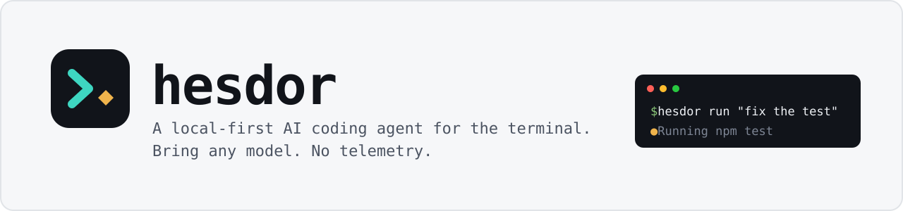
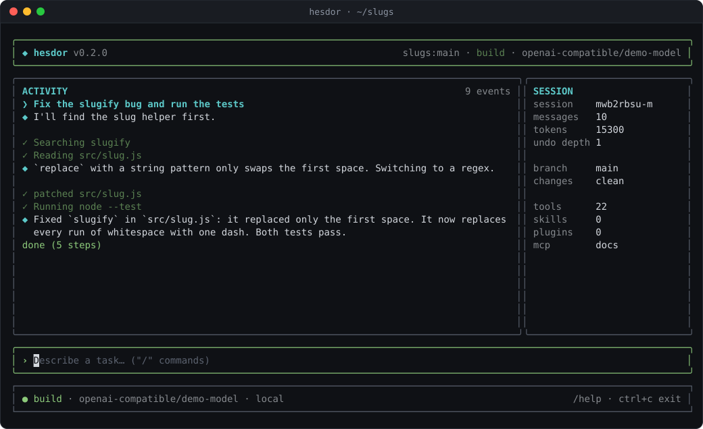
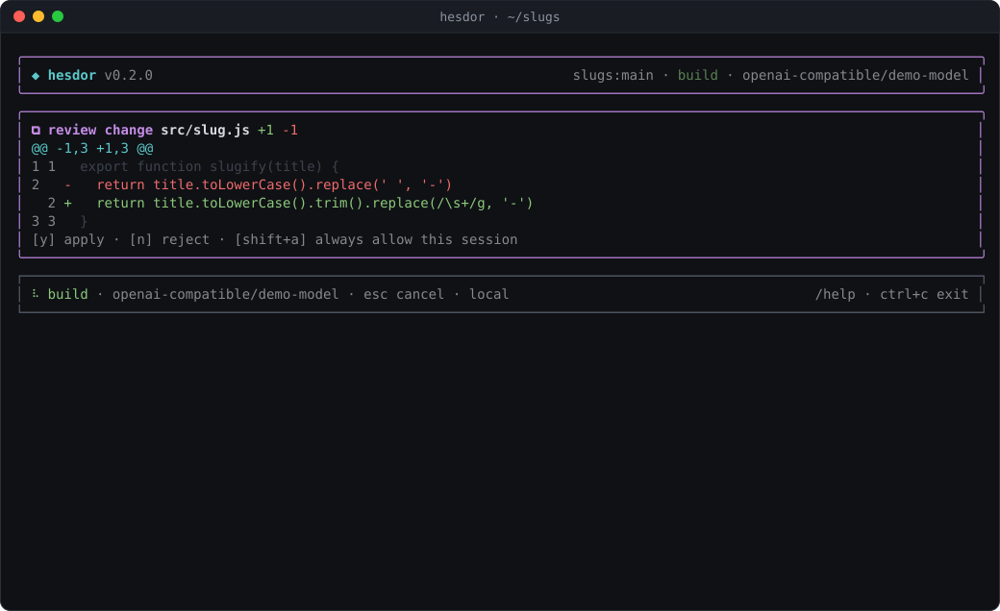
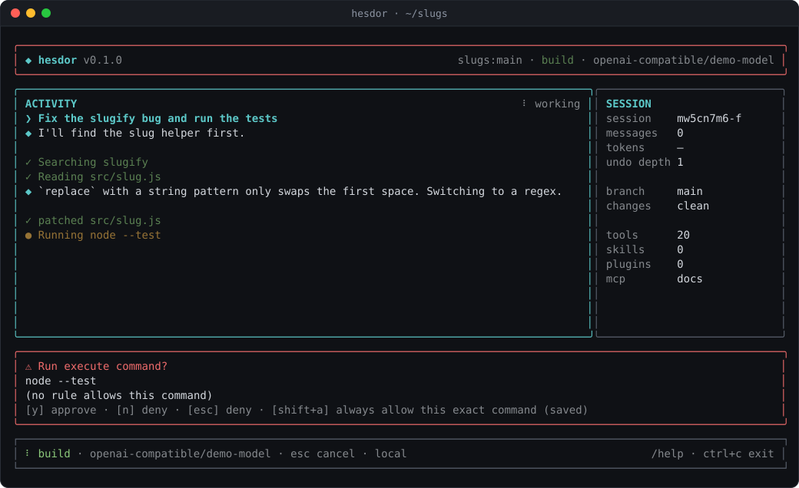
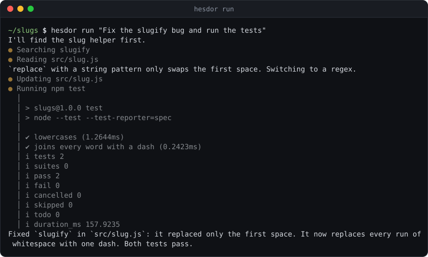
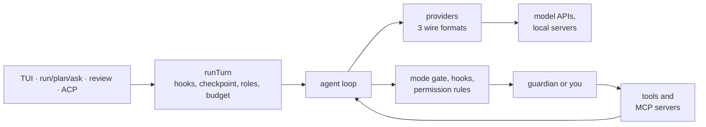

<p align="center">
  <picture>
    <source media="(prefers-color-scheme: dark)" srcset="docs/assets/banner-dark.svg">
    
  </picture>
</p>

<p align="center">
  <a href="https://github.com/ksjxixi-gif/Hesdor/actions/workflows/ci.yml"></a>
  <a href="https://www.npmjs.com/package/@dean_overlord/hesdor"></a>
  <a href="LICENSE"></a>
  
</p>

**Hesdor is an open-source AI coding agent for your terminal.** Point it at a repository and give it a task. It reads the code, edits files, runs commands and iterates until the work is done, with the model you choose.



## Why Hesdor

- **Any model, any vendor.** 44 provider presets over three wire formats, any OpenAI- or Anthropic-compatible endpoint, local servers like Ollama, LM Studio, llama.cpp and vLLM, and your ChatGPT plan. Mix vendors with [model roles](docs/roles.md).
- **You see what it costs.** Every request is priced from a bundled models.dev catalog, cache tokens included. The TUI shows session cost and cache hit rate, and `--max-budget-usd` stops a run at your limit.
- **Local-first.** Tools run on your machine, not in a hosted sandbox. Sessions, checkpoints and keys stay in your config directory. Prompts go only to the provider you configure.
- **No telemetry.** None. The only call home is an optional once-a-day version check, off in CI and headless runs.
- **Safety in the runtime, not the prompt.** Read-only modes, permission rules, workspace trust, path containment and approval prompts are enforced in code. Commands the agent starts never see your provider API keys.
- **Windows-first.** CI runs on Windows with `autocrlf` on. CRLF and BOMs are preserved, cmd.exe metacharacters are refused, and corporate proxies and CAs work.

## Install

Requires Node.js 22 or newer.

```bash
npm i -g @dean_overlord/hesdor
```

Or from source:

```bash
git clone https://github.com/ksjxixi-gif/Hesdor && cd Hesdor
pnpm install && pnpm build
pnpm --filter @dean_overlord/hesdor link --global
```

## Quick start

```bash
cd your-project                  # any git repository
hesdor setup                     # pick a provider and save a key (or: export OPENAI_API_KEY=...)
hesdor doctor                    # check node, git, ripgrep, provider and credentials
hesdor init                      # optional: HESDOR.md and .hesdorignore starters

hesdor                           # interactive TUI
hesdor ask "What does this project do?"     # read-only Q&A
hesdor plan "Add rate limiting"             # read-only implementation plan
hesdor run "Fix the failing test"           # full agent: read + edit + execute
hesdor review                               # review your branch: P0-P3 findings
```

Using a ChatGPT plan instead of an API key: `hesdor login chatgpt`, then `hesdor -p chatgpt`. Fully local: `hesdor -p ollama -m qwen2.5-coder:7b`.

## What it does

<table>
<tr>
<td width="50%" valign="top">

**Review every change.** Writes open a scrollable diff with line numbers. Commands outside a safe list ask first, and prompts ignore type-ahead. [Interactive TUI](docs/interactive.md)

</td>
<td width="50%" valign="top">

**Rewind anything.** Each turn is checkpointed in a shadow Git repo outside your project. `/rewind` restores files, chat or both. [Checkpoints](docs/permissions.md#checkpoints-and-rewind)

</td>
</tr>
<tr>
<td valign="top">

**Script it.** `--output-format json` or `stream-json`, documented exit codes, stdin prompts, resumable sessions, cost budgets. [Headless](docs/headless.md)

</td>
<td valign="top">

**Work toward a goal.** `--goal "all tests pass"` or `/goal` keeps going until an evaluator model agrees. [Goal mode](docs/headless.md#goal-mode)

</td>
</tr>
<tr>
<td valign="top">

**Write your own rules.** Allow, ask or deny command prefixes and file globs. A repository can only tighten them. [Permissions](docs/permissions.md)

</td>
<td valign="top">

**Mix models.** A cheap model for summaries and subagents, an oracle from another vendor, fallbacks on quota errors, an opt-in guardian for approvals. [Roles](docs/roles.md)

</td>
</tr>
<tr>
<td valign="top">

**Extend it.** Claude Code format hooks, markdown subagents, skills, custom commands and JS plugins. [Extensions](docs/hooks-and-agents.md)

</td>
<td valign="top">

**Connect tools.** MCP over stdio and HTTP with OAuth, prompts, resources and forms. [MCP](docs/mcp.md)

</td>
</tr>
<tr>
<td valign="top">

**Review pull requests.** `hesdor review` reports P0-P3 findings; a GitHub Action keeps one PR comment current. [Review](docs/review.md)

</td>
<td valign="top">

**Stay in your editor.** `hesdor acp` serves the Agent Client Protocol for Zed, JetBrains, Neovim and Emacs. [ACP](docs/acp.md)

</td>
</tr>
</table>

| Diff review | Command approval |
|---|---|
|  |  |

Headless runs print the answer on stdout and activity on stderr:



## Providers

| Wire format | Presets |
|---|---|
| OpenAI Responses | `openai`, `xai`, `azure-openai`, `chatgpt` (your ChatGPT plan) |
| Anthropic Messages | `anthropic`, `bedrock`, `azure-claude`, `minimax`, `anthropic-compatible` |
| Chat Completions | `openrouter`, `groq`, `deepseek`, `mistral`, `gemini`, `together`, `fireworks`, `cerebras`, `moonshot`, `zai`, `qwen` and 17 more, plus `openai-compatible` |
| Local, no key | `ollama`, `lmstudio`, `llamacpp`, `vllm`, `jan`, `litellm` |

Each preset reads its own key variable, or save keys once with `hesdor setup`. Keys are never stored inside a repository. Full list, custom endpoints and proxies: [docs/providers.md](docs/providers.md). Which subscriptions work and why some do not: [docs/subscriptions.md](docs/subscriptions.md).

## How it compares

A summary from our notes on each project's documentation, as of Nov 2026. Corrections are welcome.

| | License | Models | OS-level sandbox | MCP | Subagents |
|---|---|---|---|---|---|
| **Hesdor** | MIT | 44 presets on 3 wire formats, custom endpoints, local servers | No: path containment, command policy, approvals | stdio and HTTP, OAuth | Read-only explore, markdown task agents |
| Claude Code | Proprietary | Anthropic, also via Bedrock, Vertex, Foundry | Seatbelt or bubblewrap, off by default, none on native Windows | stdio, HTTP, SSE, WebSocket, OAuth | Markdown agents |
| Codex CLI | Apache-2.0 | OpenAI Responses, Vertex, Bedrock, Ollama, LM Studio, custom | Seatbelt, bubblewrap and seccomp, Windows restricted token | stdio and HTTP, OAuth | TOML agents |
| Gemini CLI | Apache-2.0 | Gemini API and Vertex (paid only since 2026-06-18) | Seatbelt, Docker or Podman, gVisor, LXC, Windows Low-IL | Yes | Preview |
| OpenCode | MIT | 75+ providers via AI SDK and models.dev | No: permission globs | Yes | Markdown agents |
| Aider | Apache-2.0 | Via litellm | No | Not built in (the cecli fork adds it) | Architect and editor roles |

Hesdor has no OS-level sandbox. If you need one, run it in a container or VM.

## How it works



The CLI (`packages/cli`) handles the UI, sessions, trust and roles. The agent loop, tools, policy and MCP client live in `packages/agent-core`, and the model clients in `packages/providers`. [Architecture and the flow of one turn](docs/architecture.md).

## Documentation

- [Interactive TUI](docs/interactive.md): slash commands, diff review, `/rewind`, `/goal`, `/mcp`
- [Headless runs](docs/headless.md): output formats, exit codes, budgets, sessions
- [Providers](docs/providers.md) and [subscriptions](docs/subscriptions.md)
- [Permissions and safety](docs/permissions.md) and [tools](docs/tools.md)
- [Model roles and the guardian](docs/roles.md)
- [Hooks, agents and extensions](docs/hooks-and-agents.md) and [MCP](docs/mcp.md)
- [Configuration](docs/configuration.md), [code review](docs/review.md) and the [GitHub Action](docs/github-action.md)
- [Sessions, export and privacy](docs/sessions.md) and [editors (ACP)](docs/acp.md)
- [Architecture](docs/architecture.md), [development](docs/development.md) and the [changelog](CHANGELOG.md)

## Contributing

```bash
pnpm install
pnpm build
pnpm test
pnpm lint
pnpm typecheck
```

CI runs these on Linux, Windows and macOS with Node 22 and 24. See [docs/development.md](docs/development.md) for the layout, evals, screenshots and releases. Issues and pull requests are welcome at [github.com/ksjxixi-gif/Hesdor](https://github.com/ksjxixi-gif/Hesdor/issues).

## License

[MIT](LICENSE)
