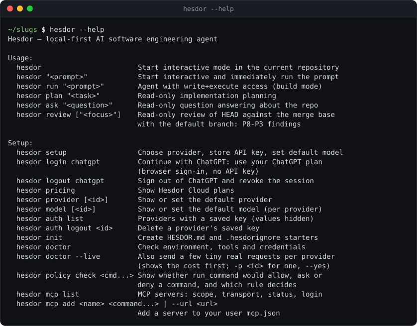

# Hesdor documentation

| Page | Covers |
|---|---|
| [interactive.md](interactive.md) | The TUI: slash commands, diff review, approvals, `/rewind`, `/goal`, `/mcp`, keys |
| [headless.md](headless.md) | `run`, `plan`, `ask` in scripts and CI: output formats, exit codes, budgets, goal mode |
| [providers.md](providers.md) | All 44 presets, models and effort, cost tracking, custom endpoints, proxies |
| [subscriptions.md](subscriptions.md) | Which subscriptions work (ChatGPT plan, coding plans) and which do not |
| [permissions.md](permissions.md) | Modes, command policy, permission rules, approvals, workspace trust, checkpoints |
| [tools.md](tools.md) | Every tool the model can call, editing, web tools, images |
| [roles.md](roles.md) | Model roles (`small`, `subagent`, `oracle`, `fallback`) and the guardian |
| [hooks-and-agents.md](hooks-and-agents.md) | Hooks, markdown subagents, custom commands, skills, plugins |
| [mcp.md](mcp.md) | MCP servers, OAuth, prompts, resources, elicitation forms |
| [configuration.md](configuration.md) | Config layers, `hesdor config`, managed settings, project context, compaction |
| [review.md](review.md) | `hesdor review` and `--worktree` |
| [github-action.md](github-action.md) | Running `hesdor review` on pull requests |
| [sessions.md](sessions.md) | Sessions, export and import, privacy and the update check |
| [acp.md](acp.md) | Using Hesdor from Zed, JetBrains, Neovim and Emacs |
| [benchmarks.md](benchmarks.md) | How Hesdor is measured: pass rate and cost per solved task |
| [architecture.md](architecture.md) | Packages and the flow of one turn |
| [development.md](development.md) | Building, testing, screenshots, releasing |

The settings schema for editors is [config.schema.json](config.schema.json). Changes are listed in the [CHANGELOG](../CHANGELOG.md).

## Command overview

The first lines of `hesdor --help`:

