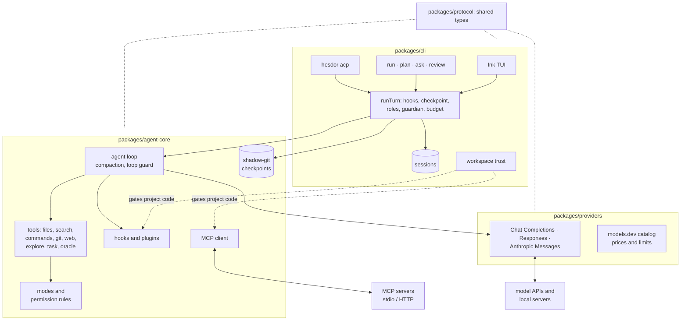
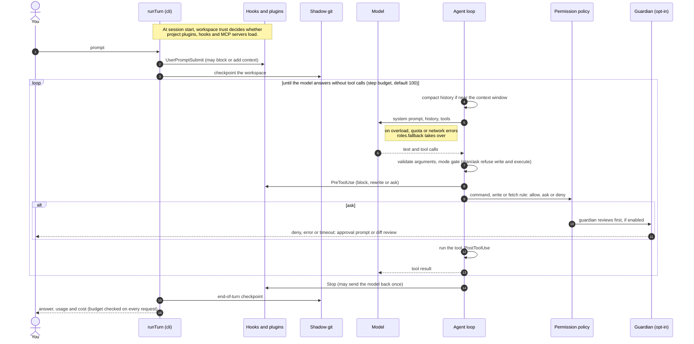

# Architecture

Hesdor is a pnpm monorepo with four packages. The published CLI (`@dean_overlord/hesdor`) bundles the other three.

| Package | Role |
|---|---|
| `packages/protocol` | Stable shared types: events, messages, tools, modes. |
| `packages/providers` | The `ModelProvider` abstraction, clients for Chat Completions, Responses and Anthropic Messages, presets, the models.dev catalog and ChatGPT sign-in. |
| `packages/agent-core` | The agent loop, tools, permission policy, repo discovery, hooks and plugins, MCP client, checkpoints. No UI dependencies. |
| `packages/cli` | Command dispatch, the Ink TUI, headless runs, review, ACP server, config layers, sessions, workspace trust, model roles, guardian and goal mode. |

## One turn

What happens between pressing Enter and seeing the answer. Code: `runTurn` in [`packages/cli/src/run.ts`](../packages/cli/src/run.ts) and `runAgentLoop` in [`packages/agent-core/src/loop.ts`](../packages/agent-core/src/loop.ts).

