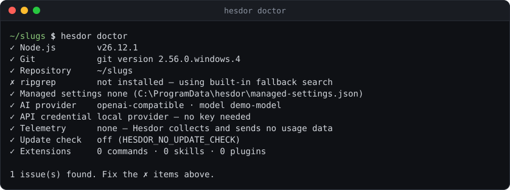

# Configuration

## Where settings come from

Settings resolve as managed settings > command-line flags > environment (`HESDOR_PROVIDER`, `HESDOR_MODEL`, `HESDOR_MAX_TOKENS`, `HESDOR_EFFORT`, `HESDOR_MODE`) > project `.hesdor/config.json` > your `config.json` > defaults.

- Your `config.json` lives in `%APPDATA%\hesdor\` on Windows or `~/.config/hesdor/` elsewhere. Credentials are stored separately, never inside a repository.
- A project file is read only in a trusted repository and may set only `mode`, `maxTokens`, `effort` and `model` (for the provider you already use).
- `hesdor config list` shows every effective value and the layer that set it; `hesdor config get <key>` prints one and `hesdor config set <key> <value>` saves a validated value in your user `config.json`. `/config` shows the same list in the TUI.
- [`config.schema.json`](config.schema.json) gives editor completion through `"$schema"`.

Other keys documented elsewhere: `permissions` ([permissions.md](permissions.md)), `customProviders` and `maxTokens` ([providers.md](providers.md)), `roles` and `guardian` ([roles.md](roles.md)), `updateCheck` ([sessions.md](sessions.md#privacy)).

## Managed settings

Administrators can place `managed-settings.json` in `%ProgramData%\hesdor\`, `/Library/Application Support/hesdor/` or `/etc/hesdor/` (or point `HESDOR_MANAGED_SETTINGS` at it) to lock `allowedProviders`, `provider`, `maxTokens`, `effort` and `mode`, force `permissions.ask/deny` rules, set a minimum `sandbox` that user and project settings cannot loosen, and disable the guardian, web tools, MCP or the update check. Flags cannot override these. `hesdor doctor` shows whether managed settings are in effect.

## Project context

Hesdor reads lightweight repo metadata (branch, status, manifests), your `HESDOR.md` instructions (or `AGENTS.md`, or `CLAUDE.md`, up to 32 KB) and `.hesdorignore` rules. It never loads the whole repository into model context. `hesdor init` creates starter `HESDOR.md` and `.hesdorignore` files.

The system prompt keeps a byte-stable prefix and the same name-sorted tool list in every mode, so prompt caching hits more often. It ends with an environment block (OS, shell, Node version, date) and labels the git status as a snapshot from session start.

## Context compaction

Long sessions are compacted automatically before they overflow the model's context window: old tool outputs are pruned first, then older turns are summarized (by `roles.small` when set). A context-overflow error triggers one compaction and a retry. `/compact` does it on demand and starts a new session linked to the old one.

## Checking your setup

`hesdor doctor` checks Node, Git, ripgrep, managed settings, the provider and its credential, model roles, telemetry, the update check and extensions.

