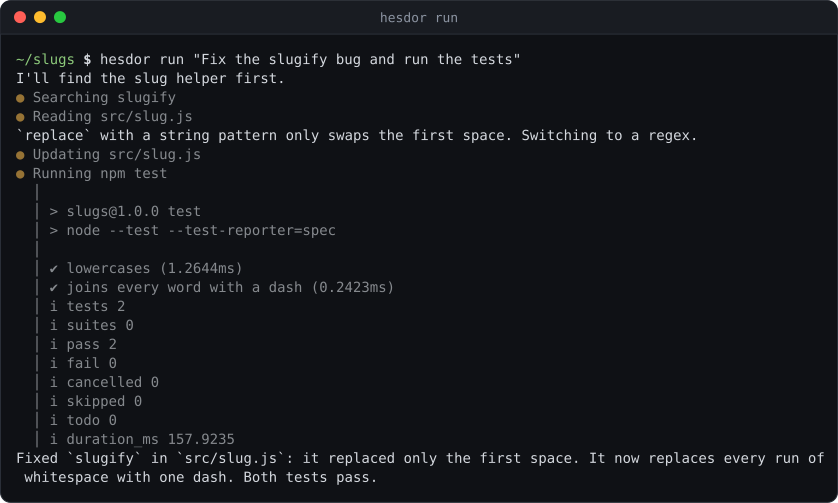

# Headless runs and scripting

`run`, `plan` and `ask` work without a terminal UI, so they fit scripts and CI:

```bash
hesdor ask "Summarize the auth flow" --output-format json      # one JSON result object on stdout
hesdor run "Fix the lint errors" --yes --output-format stream-json   # one JSON event per line
git diff | hesdor ask -                                         # "-" (or piped stdin with no prompt) reads the prompt from stdin
hesdor plan "Add caching" -o plan.md                            # also write the final answer to a file
hesdor run -c "Now add tests"                                   # continue the latest session for this workspace
hesdor run -r <session-id> "And update the docs"                # resume a specific session (ids are listed by /sessions)
```



## Output formats

- `--output-format text` (default) streams the answer to stdout and activity to stderr.
- `json` prints only the final object: `{ type: "result", status, result, session_id, usage, cost_usd, steps, error, error_category }`. `usage` includes tokens spent by subagents, and `cost_usd` is the run's cost in USD (`null` when the model has no known price).
- `stream-json` prints an `init` event (session id, provider, model, mode, tools, plugins, MCP servers, warnings), then every run event, explore-subagent events wrapped as `{ "type": "subagent", "event": ... }`, and the same `result` object last.

## Exit codes

| Exit code | Meaning |
|---|---|
| 0 | completed |
| 1 | failed (agent error, bad arguments, unknown session, workspace refused) |
| 2 | stopped at the step budget (`--max-steps`) |
| 3 | provider or infrastructure error: auth or missing key, network, rate limit after retries, quota, overload; `error_category` names it |
| 4 | stopped at the cost budget (`--max-budget-usd`) |
| 5 | `hesdor review` found an issue at or above `--severity` |
| 6 | `--goal` was judged impossible or ran out of turns |
| 130 | cancelled (Ctrl+C) |

## Budgets

The default step budget is 100 tool-call steps (`--max-steps <n>`). When it runs out, the model gets one final call to summarize. Repeating the same tool call 3 times, or editing one file 5 times, is refused as a loop.

`--max-budget-usd <n>` stops a run once its cost reaches $n. Costs come from a bundled models.dev price snapshot, including cache read/write tokens, or from the provider's own reported cost when it sends one.

## Goal mode

`hesdor run --goal "all tests pass" "fix the failing tests"` keeps working turn after turn until an evaluator model (`roles.small`, else the main model) judges the goal met. It exits 0 when the goal is met and 6 when it is impossible or `--max-goal-turns` (default 10) runs out. The TUI has the same loop as `/goal <condition>`.

## Approvals, trust and images

Headless runs never prompt. Risky commands are refused unless you pass `--yes` (see [permissions.md](permissions.md)), project plugins, hooks and MCP servers load only with a stored approval or `--trust-workspace`, and MCP forms are declined. `--guardian` lets the guardian model approve risky commands; a deny or error refuses them (see [roles.md](roles.md)).

`--image <file>` (repeatable) or `@path/to/shot.png` in the prompt attaches images (see [tools.md](tools.md#images)).

## Sessions

Headless runs are saved as sessions just like interactive ones; `-c`/`--continue` and `-r`/`--resume <id>` (unique prefixes work) also work for the interactive UI. `/clear` and `/compact` start a new session linked to the previous one, so the full transcript is never overwritten. See [sessions.md](sessions.md).

## Outside a Git repository

Outside a Git repository Hesdor uses the current directory as the workspace and says so; the git tools are unavailable there. It refuses to use your home directory or a filesystem root (including a dotfiles repository at `~/.git`) unless you pass `--allow-home`.

## Worktrees

`--worktree[=name]` runs `run`, `plan` or `ask` in a new git worktree; see [review.md](review.md#worktrees).
