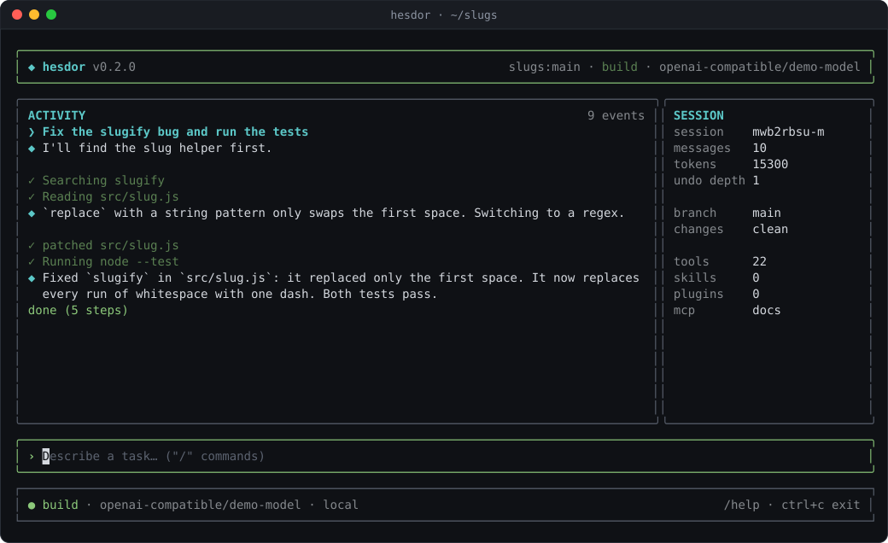
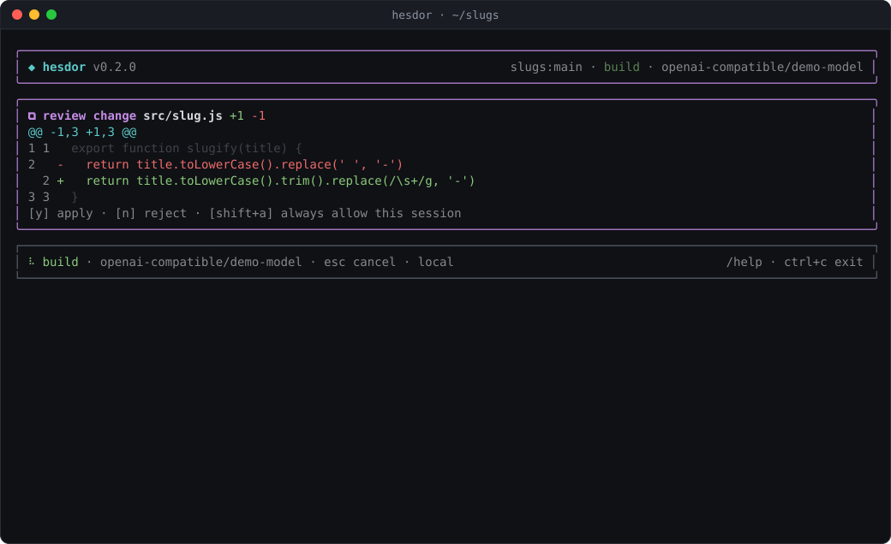
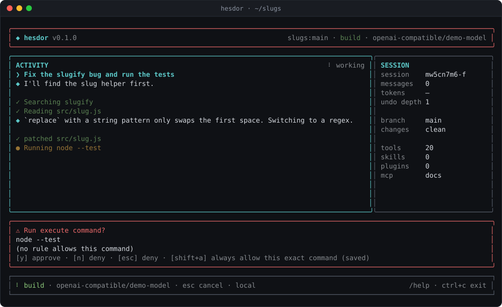
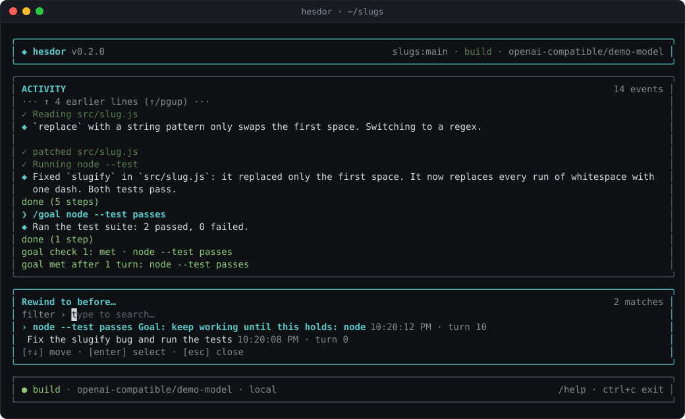
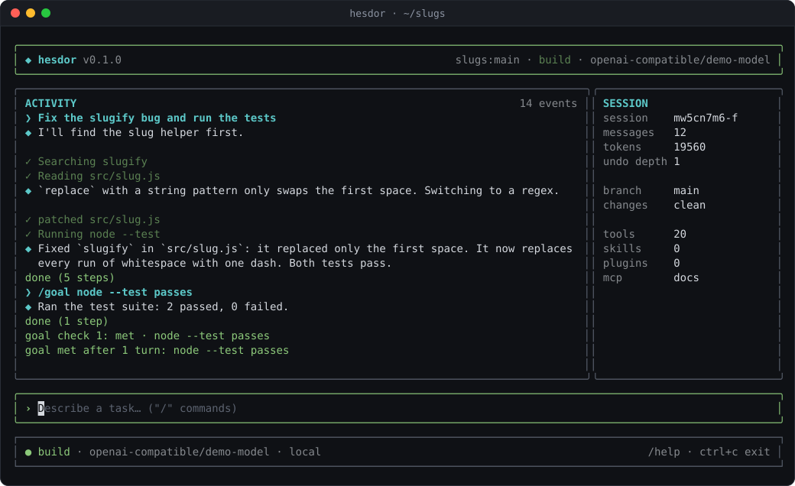

# The interactive TUI

Run `hesdor` in a repository to open the terminal UI, or `hesdor "<prompt>"` to open it and run a prompt right away. The header shows the repository, branch, mode and model; the side panel shows the session, git state and loaded extensions; the footer shows context use, session cost and cache hit rate.

## Slash commands

Type `/` to open the command palette; Enter runs the highlighted entry. Read-only commands work while the agent is running.

| Command | What it does |
|---|---|
| `/help` | list commands |
| `/model`, `/provider` | pick a model (searchable) or switch provider; while a [profile](roles.md#profiles) picks the model, `/model` lasts for the session (keep it with `hesdor config set profile none` or `-m`) |
| `/mode build\|plan\|ask` | switch mode (plan and ask are read-only) |
| `/effort low\|medium\|high\|default` | reasoning effort for this session |
| `/status` | session, model, cost and tokens |
| `/goal <condition>` | keep working turn after turn until an evaluator judges the condition met; Esc stops |
| `/config` | effective settings and the layer that set each |
| `/mcp`, `/mcp login <name>` | MCP servers and their state; log in to a URL server |
| `/rewind` | restore files, chat or both to a checkpoint |
| `/undo`, `/redo` | revert or re-apply the last file change |
| `/tools`, `/skills`, `/plugins` | what is loaded |
| `/sessions`, `/resume <n>`, `/new` | recent conversations, continue one, start fresh |
| `/compact`, `/clear` | summarize or clear the context (both start a linked session) |
| `/reload` | rescan extensions |
| `/exit` | quit |

Custom commands, skills (`/skill-name`) and MCP prompts (`/mcp__<server>__<prompt>`) appear in the palette too.

## Approving changes

Every file write opens a diff review: `y` applies, `n` rejects, Shift+A allows writes for the rest of the session. Commands outside the safe list open an approval prompt: `y` approves, `n` or Esc denies, Shift+A saves a permanent allow rule for exactly that command. Both ignore keys for 300 ms after they open, and Enter never approves. See [permissions.md](permissions.md).

| Diff review | Command approval |
|---|---|
|  |  |

## Rewind

Each turn is checkpointed. `/rewind` lists the turns of this session; pick one, then choose files, chat or both. Running `/rewind` again offers to undo the last rewind.

Rewinding the chat continues in a new session linked to the old one, so the full transcript stays saved and `/sessions` lists both. `/rewind` in the new session still lists the old session's turns up to the rewind point (until `/new`, `/clear`, `/compact` or `/resume`).

## Goals

`/goal <condition>` runs turns until an evaluator model (`roles.small`, else the main model) judges the condition met, impossible, or out of turns. Each check shows as a status line.

## MCP

`/mcp` lists MCP servers; Enter on a URL server starts an OAuth login. When a server asks for input, a form opens in the TUI. See [mcp.md](mcp.md#in-the-tui).

## Keys

- Esc cancels the running turn (and `/compact`).
- Ctrl+C aborts the running turn (commands and pending writes), then exits.
- The transcript scrolls by wrapped lines with ↑/↓ and PgUp/PgDn.
- A prompt typed while the agent works is queued and runs with the mode and model current when it starts.
