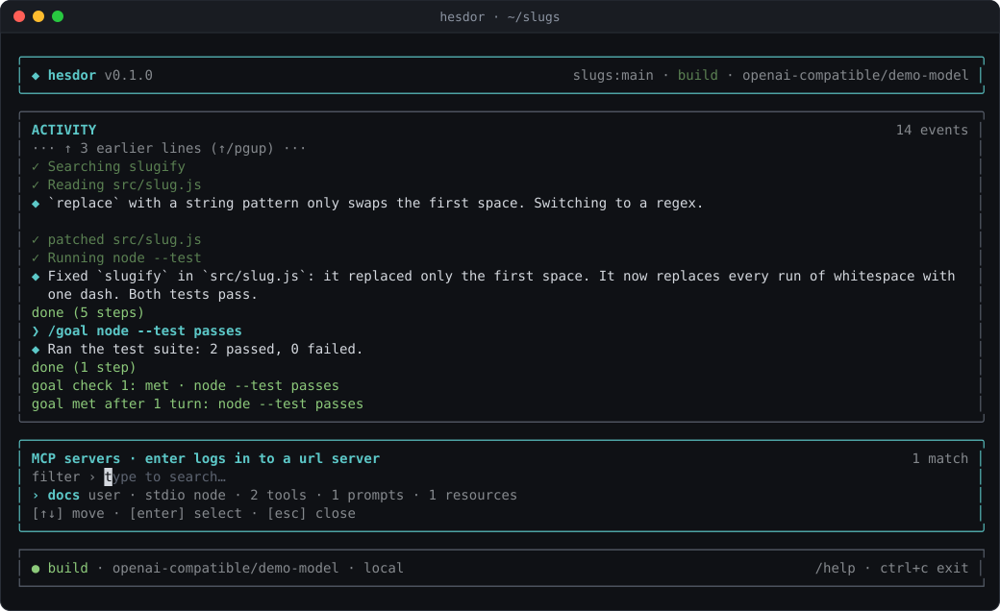
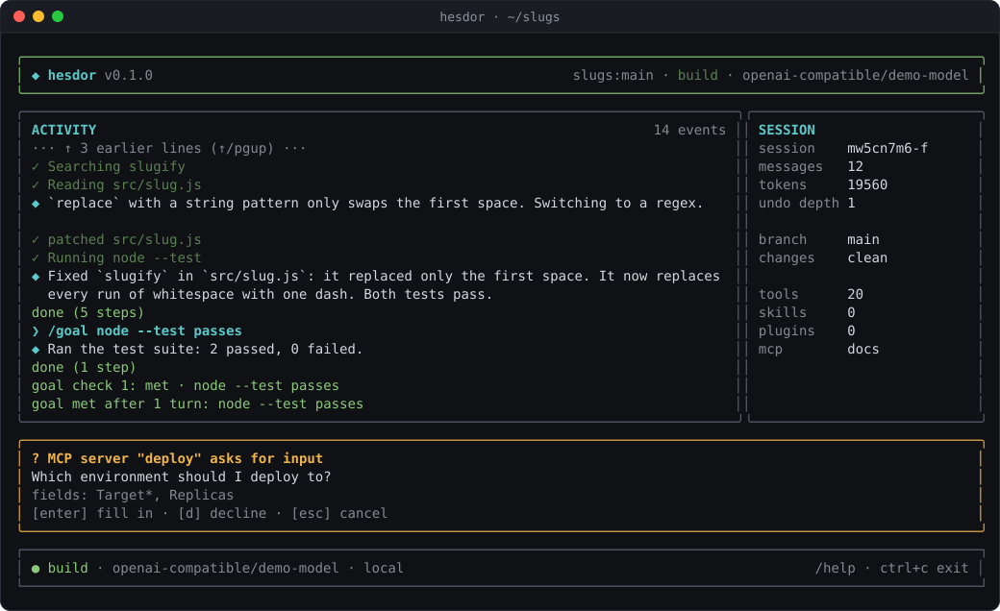

# MCP servers

Hesdor connects to Model Context Protocol servers over stdio and Streamable HTTP, using the official TypeScript SDK client with protocol version negotiation (2026-07-28 and earlier servers).

```bash
hesdor mcp add github --url https://api.githubcopilot.com/mcp/
hesdor mcp login github        # OAuth in the browser; tokens stored per server, mode 0600
hesdor mcp add files npx -y @modelcontextprotocol/server-filesystem .
hesdor mcp list
```

## Configuration

`hesdor mcp add` writes your user `mcp.json` in the config directory:

```json
{ "mcp": { "files": { "command": "npx", "args": ["-y", "@modelcontextprotocol/server-filesystem", "."] },
           "github": { "url": "https://api.githubcopilot.com/mcp/", "headers": { "X-Team": "core" } } } }
```

A repository can add servers in `.hesdor/mcp.json` or `.mcp.json` (Claude Code format); both load only after you trust the workspace (see [permissions.md](permissions.md#workspace-trust)). Values support `${VAR}` expansion, and a server can set `disabled: true` or its own `timeout`. Servers start in parallel and reconnect automatically after they die. Tools appear as `mcp_<server>_<tool>`; image, resource and structured results are passed through.

## OAuth

Remote servers that need a login use OAuth 2.1 with PKCE as the MCP 2026-07-28 spec describes (protected resource metadata, resource indicators, issuer check). Tokens are stored per server URL with mode 0600 and never sent to another origin. `hesdor mcp logout <name>` forgets them.

## Prompts, resources and forms

- Prompts run as `/mcp__<server>__<prompt> [arg=value ...]`.
- The model reads resources with the read-only `mcp_read_resource` tool.
- Servers can ask you questions through a form (elicitation). Headless runs decline them.

Tool annotations such as `readOnlyHint` set a tool's risk only for servers in your own `mcp.json`; a repository's servers stay network-risk whatever they claim. MCP output is framed as untrusted, and later approval prompts say "after reading web/MCP content".

## In the TUI

`/mcp` lists every server with its scope, transport and state (tools, prompts and resources, or disconnected). Press Enter on a URL server to log in, or type `/mcp login <name>`.



When a server asks for input, a form opens: Enter fills it in, `d` declines and Esc cancels. Each field is a separate step, and you review the answers before anything is sent. Like approval prompts, every step ignores keys for 300 ms so type-ahead cannot answer it.


