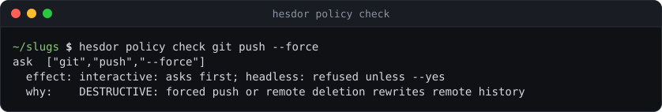
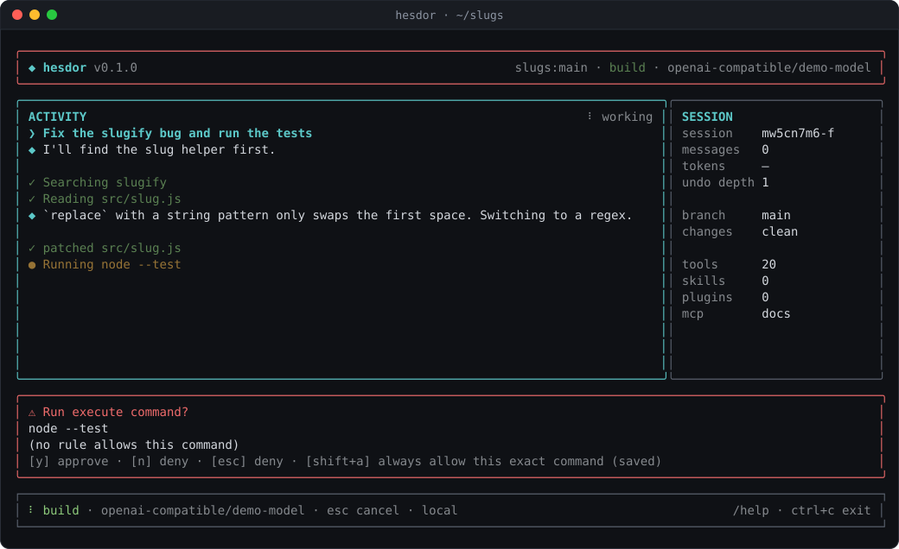

# Permissions and safety

Hesdor runs on your machine with your user's rights. It contains paths, classifies commands, asks before risky actions and lets you write rules, and can run commands in an optional OS sandbox (off by default). This page lists what each layer does.

## Modes

| Command | Mode | Capabilities |
|---|---|---|
| `hesdor` | build (switchable with `/mode`) | interactive Ink UI |
| `hesdor run "<prompt>"` | build | read + write + execute |
| `hesdor plan "<task>"` | plan | read-only |
| `hesdor ask "<question>"` | ask | read-only |

Modes are enforced by hard permission checks in the runtime, not by prompt instructions: in `plan`/`ask` the write/execute tools are refused no matter what the model asks for, and plan and ask modes cannot run a subagent whose tools could write or execute.

## Filesystem containment

Filesystem tools are confined to the repository root. Traversal attempts (`../`, absolute external paths, symlinks or junctions that point outside) are rejected before execution, because the tools resolve real paths. The agent can never write or delete files inside `.git` (hooks there run on your next commit), whatever the approval.

## Command policy

`run_command` does not use a shell: the string is split into arguments and run directly, so `&&`, pipes and redirects do not work and one command can never become two. On Windows, arguments containing cmd.exe metacharacters (`& | < > ^ % ! "` or line breaks) are refused instead of quoted.

Destructive and network-touching commands (`rm -rf`, `git reset --hard`, `sudo`, ...) and commands that run code Hesdor cannot inspect need explicit approval and are blocked outright in headless runs unless you pass `--yes`:

- shells (`bash`, `sh`, `cmd`, `powershell`, `pwsh`, `wsl`, ...), inline code (`node -e`, `python -c`, `ruby -e`, `php -r`, ...), wrappers (`npx`, `xargs`, `env`, `timeout`, ...), `npm|pnpm|yarn|bun dlx/exec/x`, and `find -exec/-delete`;
- risky git commands: `reset --hard/--keep/--merge`, `clean -f`, `checkout -- .`/`--force`, `restore`, `stash drop/clear`, `branch -D`, force pushes, `push --delete`/`--mirror`/`+refspec`, `reflog expire/delete`, `filter-repo`, `update-ref -d`, `git config` writes, and global options that can run programs or target another repository (`-c`, `--exec-path`, `--git-dir`, `--work-tree`, `--config-env`).

Hesdor's own git calls ignore `core.fsmonitor` and hooks, and `git_diff` ignores external diff and textconv drivers. Commands and MCP servers started by the agent do not see your model-provider API keys (every preset key plus any `HESDOR_*` variable) or web-search keys. Headless runs refuse to run as root unless `--allow-root` is passed, and warn under `pull_request_target`.

## Permission rules

Your user `config.json` can allow, ask about or deny commands and file writes:

```json
{ "permissions": {
    "allow": ["pnpm test", ["git", "commit"], { "write": "docs/**" }],
    "ask":   ["make deploy", { "write": "package.json" }],
    "deny":  ["git push", { "write": "secrets/**" }] } }
```

A string is a command prefix, an array is an argv prefix, and `{ "write": glob }` matches files the agent writes or deletes. `{ "fetch": "host-glob" }` allows `web_fetch` for matching hosts (see [tools.md](tools.md)). Deny beats ask beats allow, and built-in risky commands are only relaxed by a user rule naming exactly that command. A project's `.hesdor/permissions.json` can only add `ask` and `deny` rules: a repository can never allow anything. Administrators can force rules through managed settings (see [configuration.md](configuration.md)).

In the interactive UI, commands outside a small safe list (read-only git, `ls`, test, lint and build scripts) ask first, and Shift+A ("always allow") saves a permanent rule for exactly that command. Headless runs without `--yes` behave as before: risky commands are refused, others run.

Check a command with `hesdor policy check`:



## Sandbox

`run_command` and background jobs can run inside an OS sandbox. Set it in your user `config.json`:

```json
{ "sandbox": { "mode": "workspace-write", "network": "off", "failIfUnavailable": false } }
```

| Key | Values |
|---|---|
| `mode` | `off` (default), `workspace-write` (writes only inside the workspace and a temp dir), `read-only` (writes only to a temp dir) |
| `network` | `off` (default), `on`, or `allowlist` with `allowDomains`. The allowlist is **not enforced yet**: with `allowlist` the network stays off. |
| `failIfUnavailable` | `true` refuses to run commands when the sandbox cannot be set up; otherwise they run unsandboxed (and ask as usual) |

- **Linux:** [bubblewrap](https://github.com/containers/bubblewrap) (`bwrap`, e.g. `sudo apt-get install bubblewrap`). `/` is mounted read-only, `/tmp` is private, `/dev` and `/proc` are fresh, the workspace is writable, and the command gets its own network namespace unless `network` is `on`. On Ubuntu 24.04+ AppArmor can block bwrap's user namespaces; `hesdor doctor` shows the error.
- **macOS:** Seatbelt (`sandbox-exec`, built in) with a generated profile: writes are allowed only in the workspace and temp dirs, and IP networking is denied unless `network` is `on`.
- **Windows:** not supported yet. A configured sandbox prints a warning and commands run unsandboxed, unless `failIfUnavailable` makes them refuse.

In `workspace-write` mode `.git/hooks` and `.git/config` stay read-only, because git runs programs from them outside the sandbox. Reads are not restricted, so a sandboxed command can read files in your home directory; with the network off it cannot send them anywhere. Tools that write caches in your home directory (for example `go build` into `~/.cache`) fail in the sandbox.

While the sandbox works, a command that would only ask because no rule covers it runs without a prompt: the sandbox replaces the prompt. Deny rules, ask rules and built-in risky classifications (`rm -rf`, `git push --force`, `curl`, shells, inline code, ...) still apply, and approved commands also run inside the sandbox. When a sandboxed command fails with a permission or network error, its result names the sandbox rule that blocked it. `hesdor doctor` shows whether the sandbox is configured and available.

Project `.hesdor/config.json` (trusted workspaces only) can only make the sandbox stricter, and managed settings can set a `sandbox` floor that user and project config cannot go below. The sandbox is off by default while the feature is new.

## Approvals

Approval prompts and the diff review ignore keystrokes for 300 ms after they open, so type-ahead cannot answer them. Enter does not approve a change: press `y`. After the agent has read web or MCP content, approval prompts say "after reading web/MCP content". Hooks can also block a tool call or ask you about it (see [hooks-and-agents.md](hooks-and-agents.md)), and the opt-in guardian can approve calls that no rule settles (see [roles.md](roles.md)).



## Workspace trust

A repository's `.hesdor/plugins/*.js`, `.hesdor/hooks.json`, `.hesdor/mcp.json`, `.mcp.json` and `.hesdor/config.json` can run code or change behavior, so Hesdor only loads them after you approve them once per repository. The approval is pinned to their exact content; any change asks again. Headless runs never prompt: they load project code only if you approved it before or pass `--trust-workspace`. `hesdor doctor` does not import project plugins and reports untrusted ones.

## Checkpoints and rewind

Before each turn Hesdor snapshots the workspace into a shadow Git repository in your config directory (never your project's `.git`), covering shell-command edits and binary files. `/rewind` restores files, the conversation, or both, to an earlier turn, warns about files you edited by hand since, and can undo the last rewind. `/undo` and `/redo` revert or re-apply the agent's last file change.

Each workspace keeps at most its newest 100 checkpoints, and none older than 30 days. Hesdor prunes in the background when a session starts, at most once a day per workspace, and runs `git gc --prune=now` on the shadow repository only when something was removed. `hesdor checkpoints` lists this workspace's checkpoints; `hesdor checkpoints prune` applies the limits now, and `--all` does it for every workspace in the store (including projects you have deleted).

## Files on disk

Credentials and saved session transcripts are written with mode `0600` in a `0700` directory. Config, credentials and sessions are written through a temp file and rename; a malformed JSON config stops with an error instead of being overwritten.
