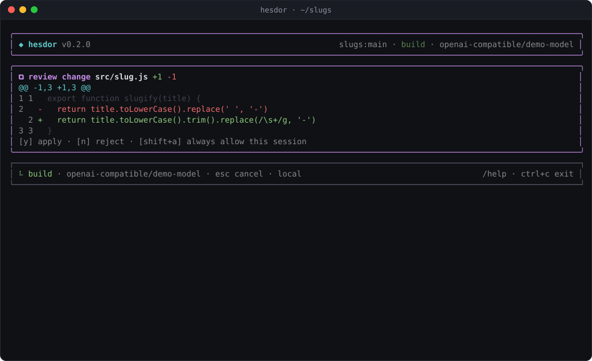

# Tools

The model works through these tools. Every call is validated against the tool's schema and checked against the current mode and your permission rules before it runs (see [permissions.md](permissions.md)).

- Files: `list_files`, `find_files` (glob patterns such as `src/**/*.test.ts`), `read_file`, `read_files`, `search_files` (ripgrep when installed, Node fallback otherwise), `write_file`, `apply_patch`, `delete_file`
- Commands: `run_command` (with `background: true` for dev servers and watchers), `job_output`, `job_list`, `job_stop`
- Git: `git_status`, `git_diff`, `git_log`
- `explore`: hands a repository-wide investigation to a read-only subagent
- `task`: runs one of your markdown subagents (see [hooks-and-agents.md](hooks-and-agents.md))
- `oracle`: asks a second model for a read-only opinion, when `roles.oracle` is set (see [roles.md](roles.md))
- `read_skill`: loads a skill's instructions (registered when skills exist)
- `web_fetch` and `web_search` (below)
- MCP server tools, named `mcp_<server>_<tool>`, and `mcp_read_resource` (see [mcp.md](mcp.md))

## Editing

`apply_patch` edits by exact text replacement. It falls back to a whitespace-tolerant match when exactly one location fits, quotes the nearest lines when nothing matches, and refuses to patch a file that changed on disk since the agent read it. `apply_patch` and `write_file` keep a file's CRLF line endings and UTF-8 BOM.

In the TUI every write opens a diff review first: full height and scrollable (arrows, PgUp/PgDn, Home/End), with old and new line numbers, `@@` hunk headers, and visible tabs and trailing spaces on changed lines. `/undo` and `/redo` revert or re-apply the last change, binary files included.

## Reading and output

`read_file` shows line numbers, refuses huge files, recognizes binary files and slices by bytes, returning an offset to continue from. Tool results are plain text; long outputs keep the first 40% and last 60%, with the full text saved to `.hesdor/out/`. Search honors `.hesdorignore`, and an invalid regex is searched as plain text.

## Commands

`run_command` runs one command without a shell (no `&&`, pipes or redirects). Background jobs' process trees are killed when Hesdor exits, and a cancelled command never leaves its children running.

## Web tools

`web_fetch` reads an http(s) page as text in build mode. It asks before every fetch unless a user rule allows the host, for example `"permissions": { "allow": [{ "fetch": "docs.python.org" }] }`. Local, private and cloud-metadata addresses are always refused (loopback, private, CGNAT, link-local, multicast and reserved, IPv4 and IPv6), DNS is re-checked on every redirect, and `web_fetch` does not use `HTTPS_PROXY`. Zero-width, bidi and Unicode tag characters are stripped. `web_search` appears when `BRAVE_API_KEY`, `TAVILY_API_KEY`, `EXA_API_KEY` or `SEARXNG_URL` is set. Web and MCP output is framed as untrusted, and later approval prompts say so.

## Images

`--image <file>` (repeatable) or `@path/to/shot.png` in a prompt attaches PNG, JPEG, GIF or WebP images up to 3.75 MB. Models with vision also see images they open with `read_file`. A model the catalog marks as text-only gets a short note instead. The Anthropic, Chat Completions and Responses wire formats all carry images.
