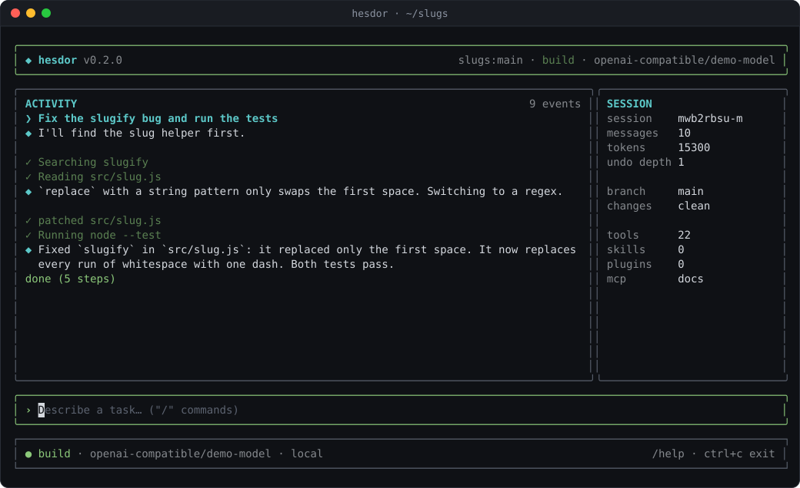

# Hesdor

An open-source AI coding agent for your terminal. It works with any model, tells you what every run costs, and never trusts a repository by default.



## Install

Requires Node.js 22 or newer.

```bash
npm i -g @dean_overlord/hesdor
```

Standalone binaries that need no Node.js are attached to each [GitHub release](https://github.com/ksjxixi-gif/Hesdor/releases).

## Quick start

```bash
cd your-project
hesdor setup                                 # pick a provider and save a key
hesdor                                       # interactive terminal UI
hesdor ask "What does this project do?"      # read-only question
hesdor run "Fix the failing test"            # full agent: read, edit, run
hesdor review                                # review your branch
```

Use a ChatGPT plan instead of an API key with `hesdor login chatgpt`. Let Hesdor pick models from the keys you have with `hesdor --profile economy`.

## What you get

- **Any model.** 44 provider presets on three wire formats, custom endpoints and local servers. Mix vendors on purpose: a cheap helper model, an oracle from another vendor, fallbacks, and escalation when a run is stuck.
- **Costs you can see.** Every request is priced, and `--max-budget-usd` stops a run at your limit.
- **Safe by default.** A cloned repository cannot run its plugins, hooks or MCP servers until you approve them. Commands Hesdor cannot inspect ask first. Permission rules, checkpoints with `/rewind`, and an optional sandbox on Linux and macOS.
- **No telemetry.**
- **Fits your tools.** MCP with OAuth, editors through the Agent Client Protocol, `AGENTS.md`, skills, hooks, subagents, and scriptable JSON output.

## Documentation

- [README](https://github.com/ksjxixi-gif/Hesdor#readme)
- [Docs](https://github.com/ksjxixi-gif/Hesdor/tree/main/docs)
- [Changelog](https://github.com/ksjxixi-gif/Hesdor/blob/main/CHANGELOG.md)
- [Issues](https://github.com/ksjxixi-gif/Hesdor/issues)

MIT licensed.
